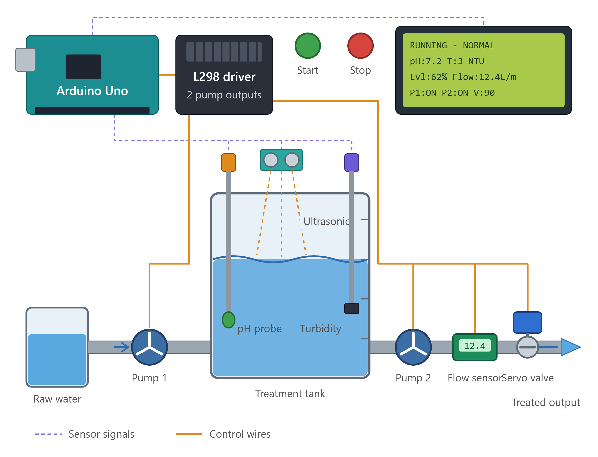
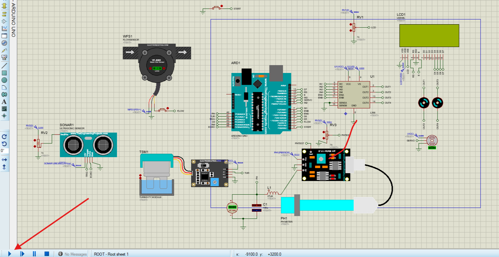

# Automated Water Treatment & Tank Control System

An Arduino-based automated water quality monitoring and tank management system simulated in **Proteus 8.12**. The system fills a treatment tank, continuously tests the water (pH and turbidity), sends good water to the treated output, flushes bad water to waste, and protects the transfer pump against dry-running or blocked pipes.



---

## How It Works

1. **Fill:** Pump 1 pulls raw water into the tank when the level is low and stops when it is full.
2. **Inspect:** pH and turbidity are measured continuously. Water is "good" only when pH is **6.5 – 8.5** and turbidity is **≤ 5 NTU**.
3. **Deliver:** If the water is good, Pump 2 moves it out and a servo-driven 3-way valve routes it to the **treated output**.
4. **Flush:** If the water stays bad, the valve routes Pump 2's output to **waste** until the tank is nearly empty, then Pump 1 refills it and the water is tested again.
5. **Protect:** Overflow, a failed level sensor, bad incoming water and a blocked or dry Pump 2 all shut things down and raise an alarm.

An operator uses **one ON/OFF switch** and reads everything on the LCD.

---

## Key Features

* **Automatic tank level control:** Pump 1 starts at **≤ 30 %** and stops at **≥ 75 %** (hysteresis, so it does not chatter). Overflow cutoff at **90 %**. If the level sensor fails, the system treats it as overflow and fills nothing.
* **Water quality inspection:** pH and turbidity (NTU) are averaged over 20 samples and smoothed with an exponential moving average.
* **3-way diverter valve (servo):** `0°` closed, `90°` treated output, `180°` waste.
* **Bad-water flush:** water must stay bad for **3 s** (debounce) before a flush starts. The tank is drained to waste down to **10 %**, then refilled and re-tested. After **3 flushes in a row** the source itself is considered bad and the system stops with `ALARM: SOURCE BAD`.
* **Low-flow protection:** if Pump 2 is running and flow stays below **10 L/min** for **3 s**, Pump 2 is stopped and the alarm is latched. Flip the switch OFF and back ON to reset it.
* **Accurate flow measurement:** flow is calculated from the flow sensor's pulses over the real elapsed time, so slow loop passes do not inflate the reading.
* **Single ON/OFF switch:** `1` = system ON, `0` = system OFF. Switching ON clears all latched alarms.
* **Live 20x4 LCD dashboard:** system status, pH, turbidity, level, flow, pump states and valve position.

---

## LCD Display

```text
RUNNING - NORMAL
pH:7.2 T:3 NTU
Lvl:62% Flow:12.4L/m
P1:ON  P2:ON  V:OUT
```

| Line | Shows |
| :--- | :--- |
| 1 | `STOPPED`, `RUNNING - NORMAL`, `RUNNING - ALARM`, `FLUSHING BAD WATER`, or `ALARM: SOURCE BAD` |
| 2 | pH and turbidity (NTU) |
| 3 | Tank level (`ERR` if the level sensor fails) and flow in L/min |
| 4 | Pump 1, Pump 2, and valve (`OUT` = treated output, `WST` = waste, `OFF` = closed) 

---

## Repository Structure

```text
Water Treatment/
├── .gitignore
├── README.md
├── docs/
│   └── images/                         # Screenshots and diagrams used in this README
├── firmware/
│   └── water_treatment/
│       └── water_treatment.ino         # Main Arduino sketch
└── Simulation/
    ├── industerial Control.pdsprj      # Proteus 8 simulation project
    ├── HEX/                            # Compiled firmware & sensor models
    │   ├── water_treatment.ino.hex
    │   ├── pHMeterLibraryTEP.HEX
    │   └── UltraSonicTEP.HEX
    └── libraries/                      # Required Proteus 8 component libraries
        ├── Arduino Library for Proteus.rar
        ├── Electronics-Tree-Flow-Sensor-Library.zip
        ├── Electronics-Tree-Turbidity-Sensor-Library.zip
        ├── PHMeterLibraryforProteus.zip
        ├── Ultrasonic Sensor Library for Proteus.rar
        └── Password.txt
```

---

## Hardware Pinout

| Component | Signal / Pin | Arduino Uno Pin | Notes |
| :--- | :--- | :--- | :--- |
| **pH Sensor** | Analog Out | `A0` | Good range: `6.5 – 8.5` |
| **Turbidity Sensor** | Analog Out | `A1` | Good range: `≤ 5.0 NTU` |
| **Ultrasonic Sensor** | Trigger / Echo | `A2` / `A5` | 400 cm tank height reference (hardware mode) |
| **Flow Sensor** | Pulse Out | `2` (INT0) | External interrupt, `450 pulses/L`, on the Pump 2 outlet line |
| **Pump 1 (Intake, L298)** | EN / IN1 / IN2 | `5` / `7` / `8` | PWM `200`; ON ≤ 30 %, OFF ≥ 75 % |
| **Pump 2 (Transfer, L298)** | EN / IN3 / IN4 | `6` / `10` / `A4` | PWM `180`; output or flush |
| **Diverter Servo Valve** | PWM Signal | `9` | `0°` closed, `90°` treated output, `180°` waste |
| **ON/OFF Switch** | Level input | `0` | `1` = ON, `0` = OFF (`INPUT_PULLUP`) |
| **20x4 LCD** | RS, EN, D4, D5, D6, D7 | `12, 11, A3, 3, 4, 13` | 4-bit parallel mode |

> **Note:** pins `0` and `1` are the Arduino's serial pins, so `Serial` cannot be used for debugging while the switch is on `0`. Pin `1` is free.

### ON/OFF switch wiring

The switch input uses the internal pull-up, so an open or high input reads `1` (ON) and an input tied to ground reads `0` (OFF). An unconnected input therefore reads ON. If you would rather have the system stay OFF when nothing is connected, wire the switch so that closing it to ground means ON, and change this line in the sketch:

```cpp
const int SWITCH_ON_LEVEL = LOW;
```

---

## Simulation Mode vs Real Hardware

Proteus cannot make real water move, so the sketch can simulate the tank level in software:

```cpp
#define SIMULATE_LEVEL 1   // 1 = simulated tank level (Proteus), 0 = real HC-SR04
```

| | `SIMULATE_LEVEL 1` (Proteus) | `SIMULATE_LEVEL 0` (hardware) |
| :--- | :--- | :--- |
| **Tank level** | Rises while Pump 1 runs, falls at the *measured* flow while Pump 2 runs | Read from the ultrasonic sensor |
| **Flow** | Always read from the flow sensor pulses on `D2` | Always read from the flow sensor pulses on `D2` |
| **Ultrasonic / RV2** | Ignored | Used |

Simulation tuning constants:

| Constant | Default | Meaning |
| :--- | :--- | :--- |
| `SIM_FILL_PER_S` | `4.0` | Level rise in % per second while Pump 1 runs |
| `SIM_TANK_CAPACITY_L` | `10.0` | Virtual tank volume in litres; sets how fast the measured flow drains the level |

In simulation you only need to control **pH**, **turbidity** and **flow** by hand. The tank fills and empties by itself.

---

## Setting Up & Running the Simulation in Proteus 8

### 1. Install the Proteus Libraries
Before opening the project, install the custom sensor and Arduino libraries located in `Simulation/libraries/`:

1. **Extract the library archives:** Extract all `.zip` and `.rar` files inside `Simulation/libraries/` (check `Password.txt` if an archive prompts for a password).
2. **Copy the library files:** Copy all extracted `.LIB` and `.IDX` files into your Proteus `LIBRARY` folder:
   * `C:\ProgramData\Labcenter Electronics\Proteus 8 Professional\LIBRARY` *(Note: `ProgramData` is a hidden folder)*
   * Or `C:\Program Files (x86)\Labcenter Electronics\Proteus 8 Professional\DATA\LIBRARY`
3. **Restart Proteus:** Close and reopen Proteus 8 so the newly installed components load properly.

### 2. Link the `.HEX` Files
1. Open `Simulation/industerial Control.pdsprj` in Proteus 8.
2. Double-click each of the following components on the schematic and set their **Program File** field to the corresponding file inside `Simulation/HEX/`:

| Component in Proteus | `.HEX` File to Assign (`Simulation/HEX/`) |
| :--- | :--- |
| **Arduino Uno** | `water_treatment.ino.hex` |
| **pH Sensor** | `pHMeterLibraryTEP.HEX` |
| **Ultrasonic Sensor** | `UltraSonicTEP.HEX` |

### 3. Run
1. Click **Play** at the bottom-left of the Proteus window.
2. Set the ON/OFF switch on `D0` to `1`. The LCD changes from `STOPPED` to `RUNNING`.
3. Set the flow sensor to a value **above 10 L/min** *before* switching ON, otherwise the low-flow alarm will trigger after 3 seconds.



---

## Testing the Behaviour

| To test | Do this | Expected result |
| :--- | :--- | :--- |
| **Normal cycle** | Switch ON, pH in range, turbidity low, flow > 10 L/min | Level rises to 75 %, Pump 2 delivers to treated output (`V:OUT`), cycle repeats |
| **Bad water flush** | Push pH or turbidity out of range for > 3 s | `FLUSHING BAD WATER`, valve to `V:WST`, tank drains to 10 %, then refills |
| **Source alarm** | Keep the water bad through 3 flushes | `ALARM: SOURCE BAD`, everything stops |
| **Low-flow alarm** | Set flow below 10 L/min while Pump 2 runs | After 3 s Pump 2 stops, `RUNNING - ALARM` |
| **Reset an alarm** | Switch OFF, then ON | Alarms cleared, normal operation resumes |
| **Overflow** | Temporarily set `LEVEL_STOP_PUMP1` to `95` | Pump 1 cut off at 90 %, alarm shown |

---

## Modifying the Firmware

If you edit `firmware/water_treatment/water_treatment.ino`:
1. Open the sketch in the **Arduino IDE** and select **Sketch -> Export Compiled Binary** (or compile via VS Code / Arduino CLI).
2. Copy the newly generated `water_treatment.ino.hex` file into `Simulation/HEX/` to update the simulation firmware.

Main settings are constants near the top of the sketch: pH and turbidity limits, level thresholds, `MIN_FLOW`, `BAD_WATER_DELAY_MS`, `FLUSH_END_LEVEL`, `MAX_FLUSHES`.