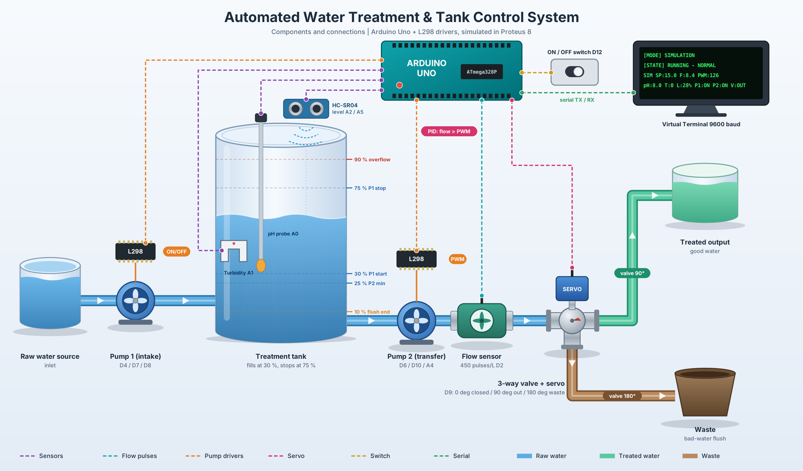
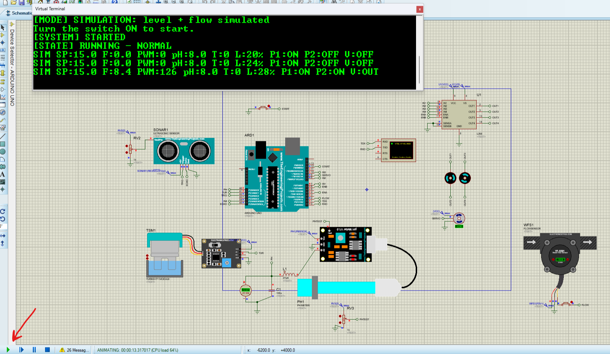

# Automated Water Treatment & Tank Control System

An Arduino-based automated water quality monitoring and tank management system simulated in **Proteus 8.12**. The system fills a treatment tank, continuously tests the water (pH and turbidity), sends good water to the treated output at a **PID-controlled flow rate**, flushes bad water to waste, and protects the transfer pump against dry-running or blocked pipes.

Everything is operated from a **Proteus Virtual Terminal** (serial, 9600 baud) and **one ON/OFF switch**.



---

## How It Works

1. **Choose a mode:** after upload the terminal shows a menu. Press `1` for **SIMULATION** or `2` for **PROTEUS**.
2. **Fill:** Pump 1 pulls raw water into the tank when the level is low and stops when it is full.
3. **Inspect:** pH and turbidity are measured continuously. Water is "good" only when pH is **6.5 – 8.5** and turbidity is **≤ 5 NTU**.
4. **Deliver:** if the water is good, Pump 2 moves it out and a servo-driven 3-way valve routes it to the **treated output**. A **PID controller** adjusts Pump 2's PWM so the measured flow tracks the flow setpoint.
5. **Flush:** if the water stays bad, the valve routes Pump 2's output to **waste** until the tank is nearly empty, then Pump 1 refills it and the water is tested again.
6. **Protect:** overflow, a failed level sensor, bad incoming water and a starved Pump 2 all shut things down and raise an alarm.

---

## Key Features

* **Two run modes, chosen at runtime** (no recompiling):
  * `1` **SIMULATION:** tank level *and* flow are both simulated in software. The flow setpoint steps automatically so you can watch the PID respond.
  * `2` **PROTEUS:** level is read from the HC-SR04 and flow from the flow-sensor pulses on `D2`; you change both by hand in Proteus.
* **PID flow control on Pump 2:** gains `Kp = 2.0`, `Ki = 3.0`, `Kd = 0.0`, with derivative on measurement (no kick on setpoint steps), a low-pass filtered D term, integrator anti-windup, and a feed-forward **bumpless start**.
* **Automatic tank level control:** Pump 1 starts at **≤ 30 %** and stops at **≥ 75 %** (hysteresis, so it does not chatter). Overflow cut-off at **90 %**. If the level sensor fails, the system treats it as overflow and fills nothing.
* **Water quality inspection:** pH and turbidity (NTU) are averaged over 20 samples and smoothed with an exponential moving average.
* **3-way diverter valve (servo):** `0°` closed, `90°` treated output, `180°` waste.
* **Bad-water flush:** water must stay bad for **3 s** (debounce) before a flush starts. The tank is drained to waste down to **10 %**, then refilled and re-tested. After **3 flushes in a row** the source itself is considered bad and the system stops with `ALARM: SOURCE BAD`. The flush counter resets once good water reaches 75 %.
* **Low-flow protection:** if Pump 2 is driven at (nearly) full PWM but the flow is still below **10 L/min** for **4 s**, Pump 2 is stopped and the alarm is latched. Switch OFF and back ON to reset it.
* **Accurate flow measurement:** flow is calculated from the flow sensor's pulses over the real elapsed time, then smoothed.
* **Single ON/OFF switch:** closing it to ground = ON. Switching ON clears all latched alarms.
* **Live serial dashboard:** a one-line status every second plus a `[STATE]` message whenever the system state changes.

---

## Virtual Terminal

Connect the Proteus **Virtual Terminal** at **9600 baud, 8N1**:

| Arduino | Terminal |
| :--- | :--- |
| `TX` (D1) | `RXD` |
| `RX` (D0) | `TXD` |

The only keys the sketch accepts are `1` and `2` (mode selection). Selecting a mode stops the system and resets the simulation; if the switch is already ON, the system starts immediately.

Example session in SIMULATION mode:

```text
[MODE] SIMULATION: level + flow simulated
Turn the switch ON to start.
[SYSTEM] STARTED
[STATE] RUNNING - NORMAL
SIM SP:15.0 F:0.0 PWM:0 pH:8.0 T:0 L:20% P1:ON P2:OFF V:OFF
SIM SP:15.0 F:0.0 PWM:0 pH:8.0 T:0 L:24% P1:ON P2:OFF V:OFF
SIM SP:15.0 F:8.4 PWM:126 pH:8.0 T:0 L:28% P1:ON P2:ON V:OUT
```

### Status line

| Field | Meaning |
| :--- | :--- |
| `SIM` / `PRO` | Active mode (simulation / Proteus) |
| `SP` | Flow setpoint in L/min (`0.0` when stopped) |
| `F` | Measured (filtered) flow in L/min |
| `PWM` | Pump 2 PWM output (0–255) |
| `pH`, `T` | pH and turbidity (NTU) |
| `L` | Tank level in % (`ERR` if the level sensor fails) |
| `P1`, `P2` | Pump 1 / Pump 2 `ON` or `OFF` |
| `V` | Valve: `OUT` = treated output, `WST` = waste, `OFF` = closed |

### State messages

| Message | Meaning |
| :--- | :--- |
| `[STATE] STOPPED` | System off |
| `[STATE] RUNNING - NORMAL` | Everything fine |
| `[STATE] RUNNING - ALARM: ...` | Any of: `pH/turbidity`, `overflow/level`, `LOW FLOW` |
| `[STATE] FLUSHING BAD WATER` | Draining bad water to waste |
| `[STATE] ALARM: SOURCE BAD` | Three flushes in a row failed; toggle the switch to reset |
| `[AUTO] setpoint -> X L/min` | Automatic setpoint step (SIMULATION mode only) |

---

## Modes

| | `1` SIMULATION | `2` PROTEUS |
| :--- | :--- | :--- |
| **Tank level** | Simulated: rises while Pump 1 runs, falls at the *measured* flow while Pump 2 runs | Read from the HC-SR04 (adjust `RV2` in Proteus) |
| **Flow** | Simulated pump/pipe model (first-order lag, small noise) driven by the PID's PWM | Read from the flow-sensor pulses on `D2` |
| **Flow setpoint** | Steps automatically: 15 → 30 → 20 → 40 → 25 L/min, 10 s each | Fixed at `SETPOINT_LPM` (20 L/min) |
| **What you control by hand** | pH and turbidity | pH, turbidity, level and flow |

In PROTEUS mode the flow sensor is an *input* you set by hand, so the PID cannot actually change it. Use SIMULATION mode to see the PID work, and PROTEUS mode to test the sensors and alarms.

---

## Repository Structure

```text
Water Treatment/
├── .gitignore
├── README.md
├── docs/
│   └── images/                         # Screenshots and diagrams used in this README
│       ├── system_flow.png
│       ├── system_flow.svg
│       └── proteus-schematic.png
├── firmware/
│   └── water_treatment/
│       └── water_treatment.ino         # Main Arduino sketch
└── Simulation/
    ├── industerial Control.pdsprj      # Proteus 8 simulation project
    ├── HEX/                            # Compiled firmware & sensor models
    │   ├── water_treatment.ino.hex
    │   ├── pHMeterLibraryTEP.HEX
    │   └── UltraSonicTEP.HEX
    └── libraries/                      # Required Proteus 8 component libraries
        ├── Arduino Library for Proteus.rar
        ├── Electronics-Tree-Flow-Sensor-Library.zip
        ├── Electronics-Tree-Turbidity-Sensor-Library.zip
        ├── PHMeterLibraryforProteus.zip
        ├── Ultrasonic Sensor Library for Proteus.rar
        └── Password.txt
```

---

## Hardware Pinout

| Component | Signal / Pin | Arduino Uno Pin | Notes |
| :--- | :--- | :--- | :--- |
| **pH Sensor** | Analog Out | `A0` | Good range: `6.5 – 8.5` |
| **Turbidity Sensor** | Analog Out | `A1` | Good range: `≤ 5.0 NTU` (4 V = 0 NTU, 1 V = 4000 NTU) |
| **Ultrasonic Sensor** | Trigger / Echo | `A2` / `A5` | 400 cm tank height reference (PROTEUS mode) |
| **Flow Sensor** | Pulse Out | `2` (INT0) | External interrupt, `450 pulses/L`, on the Pump 2 outlet line |
| **Pump 1 (Intake, L298)** | EN / IN1 / IN2 | `4` / `7` / `8` | Plain ON/OFF; ON ≤ 30 %, OFF ≥ 75 % |
| **Pump 2 (Transfer, L298)** | EN / IN3 / IN4 | `6` / `10` / `A4` | PWM from the PID (`40` – `255`) |
| **Diverter Servo Valve** | PWM Signal | `9` | `0°` closed, `90°` treated output, `180°` waste |
| **ON/OFF Switch** | Level input | `12` | Closed to ground = ON (`INPUT_PULLUP`) |
| **Virtual Terminal** | TX / RX | `1` / `0` | Serial, 9600 baud, 8N1 |
| *(unused analog pin)* | Random seed | `A3` | Floating input used only to seed the simulation noise |

> **Note:** the switch moved from `D0` to `D12` because `D0`/`D1` are now the serial port. The 20x4 LCD from the previous version is no longer used; the Virtual Terminal replaces it.

### ON/OFF switch wiring

The switch input uses the internal pull-up, so an **open input reads OFF** and an input **closed to ground reads ON**. This is set by:

```cpp
const int SWITCH_ON_LEVEL = LOW;   // closed to ground = ON
```

---

## Settings (edit in the sketch, then re-upload)

All main settings are in the `USER SETTINGS` block at the top of `water_treatment.ino`:

| Constant | Default | Meaning |
| :--- | :--- | :--- |
| `SETPOINT_LPM` | `20.0` | Flow setpoint (L/min) in PROTEUS mode, and in SIM mode when auto steps are off |
| `KP_INIT` / `KI_INIT` / `KD_INIT` | `2.0` / `3.0` / `0.0` | PID gains |
| `AUTO_SETPOINT_ENABLED` | `true` | Automatic setpoint steps in SIM mode |
| `AUTO_STEP_MS` | `10000` | Time per auto step |
| `AUTO_SP[]` / `AUTO_N` | `{15, 30, 20, 40, 25}` / `5` | Auto setpoint sequence (L/min) |

Other tunables further down the sketch: pH and turbidity limits, level thresholds (`LEVEL_START_PUMP1`, `LEVEL_STOP_PUMP1`, `LEVEL_MIN_PUMP2`, `LEVEL_OVERFLOW`), `MIN_FLOW`, `FLOW_ALARM_MS`, `BAD_WATER_DELAY_MS`, `FLUSH_END_LEVEL`, `MAX_FLUSHES`.

Simulation model constants:

| Constant | Default | Meaning |
| :--- | :--- | :--- |
| `SIM_FILL_PER_S` | `4.0` | Level rise in % per second while Pump 1 runs |
| `SIM_TANK_CAPACITY_L` | `100.0` | Virtual tank volume in litres; sets how fast the flow drains the level |
| `SIM_PUMP_MAX_LPM` | `60.0` | Simulated flow at full PWM and a full tank |
| `SIM_PUMP_TAU_S` | `1.0` | Time constant of the simulated pump/pipe |

---

## Setting Up & Running the Simulation in Proteus 8

### 1. Install the Proteus Libraries
Before opening the project, install the custom sensor and Arduino libraries located in `Simulation/libraries/`:

1. **Extract the library archives:** extract all `.zip` and `.rar` files inside `Simulation/libraries/` (check `Password.txt` if an archive prompts for a password).
2. **Copy the library files:** copy all extracted `.LIB` and `.IDX` files into your Proteus `LIBRARY` folder:
   * `C:\ProgramData\Labcenter Electronics\Proteus 8 Professional\LIBRARY` *(note: `ProgramData` is a hidden folder)*
   * or `C:\Program Files (x86)\Labcenter Electronics\Proteus 8 Professional\DATA\LIBRARY`
3. **Restart Proteus:** close and reopen Proteus 8 so the newly installed components load properly.

### 2. Link the `.HEX` Files
1. Open `Simulation/industerial Control.pdsprj` in Proteus 8.
2. Double-click each of the following components on the schematic and set their **Program File** field to the corresponding file inside `Simulation/HEX/`:

| Component in Proteus | `.HEX` File to Assign (`Simulation/HEX/`) |
| :--- | :--- |
| **Arduino Uno** | `water_treatment.ino.hex` |
| **pH Sensor** | `pHMeterLibraryTEP.HEX` |
| **Ultrasonic Sensor** | `UltraSonicTEP.HEX` |

### 3. Run
1. Click **Play** at the bottom-left of the Proteus window. The **Virtual Terminal** opens and shows the mode menu.
2. Click inside the terminal and press **`1`** (SIMULATION) or **`2`** (PROTEUS).
3. Close the **START** switch (to ground). The terminal prints `[SYSTEM] STARTED`.
4. In **PROTEUS** mode, set the flow sensor to a value **above 10 L/min** *before* the pump runs at full PWM, otherwise the low-flow alarm will trigger after 4 seconds.



---

## Testing the Behaviour

| To test | Do this | Expected result |
| :--- | :--- | :--- |
| **Normal cycle** | Mode `1`, switch ON, pH in range, turbidity low | Level rises to 75 %, Pump 2 delivers to treated output (`V:OUT`), flow follows the stepping setpoint, cycle repeats |
| **PID response** | Mode `1`, watch `SP`, `F` and `PWM` | `F` settles on `SP` after each `[AUTO]` step |
| **Bad water flush** | Push pH or turbidity out of range for > 3 s | `FLUSHING BAD WATER`, valve to `V:WST`, tank drains to 10 %, then refills |
| **Source alarm** | Keep the water bad through 3 flushes | `ALARM: SOURCE BAD`, everything stops |
| **Low-flow alarm** | Mode `2`, set flow below 10 L/min while Pump 2 runs at full PWM | After 4 s Pump 2 stops, `RUNNING - ALARM: LOW FLOW(...)` |
| **Level-sensor fault** | Mode `2`, make the HC-SR04 reading invalid | `L:ERR`, treated as overflow, Pump 1 off |
| **Reset an alarm** | Switch OFF, then ON | Alarms cleared, normal operation resumes |
| **Overflow** | Temporarily set `LEVEL_STOP_PUMP1` to `95` | Pump 1 cut off at 90 %, alarm shown |
| **Change mode** | Press `1` or `2` in the terminal | System stops and resets, new mode starts |

---

## Modifying the Firmware

If you edit `firmware/water_treatment/water_treatment.ino`:
1. Open the sketch in the **Arduino IDE** and select **Sketch -> Export Compiled Binary** (or compile via VS Code / Arduino CLI).
2. Copy the newly generated `water_treatment.ino.hex` file into `Simulation/HEX/` to update the simulation firmware.
